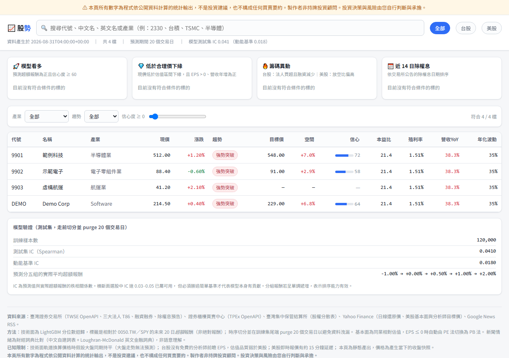
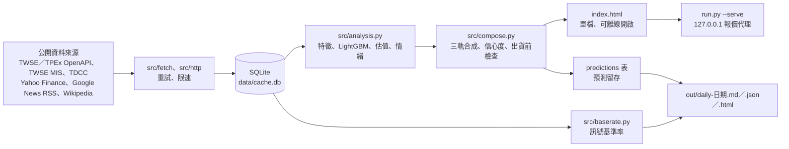

# stock-forecast-dashboard

每天抓取台股與美股的公開資料，用統計模型估算未來 20 個交易日的目標價區間、技術訊號的歷史基準率，輸出成可離線開啟的單檔 HTML 與每日日報。

> **非投資建議**：本專案所有輸出都是程式依公開資料計算的統計結果，不是投資建議，也不構成任何買賣要約。製作者不是持牌投資顧問，投資決策與風險請自行判斷與承擔。產出的頁面也會顯示同樣的聲明（`src/render.py` 的 `DISCLAIMER`），並有測試掃描頁面不得出現「建議買進」等指示性字眼。

## 要解決的問題

一般散戶看盤時常遇到三個問題：資料散在交易所、集保、Yahoo、新聞等不同來源；「技術訊號出現就會漲」這類說法很少附上歷史驗證；模型給出的單一目標價看起來很精確，卻沒有說明不確定性與適用條件。

這個專案的做法是把多個公開來源整理進同一份 SQLite，模型只輸出**區間**與**信心度**，並把「不能預測」也當成正式結果：資料不足、各軌方向分歧、信心度過低時，頁面只呈現資料、不給數字。技術訊號則先用 block bootstrap 與多重檢定校正量測歷史基準率，沒有統計優勢就明寫沒有。

難點在於資料來源不穩定（非官方 API、TLS 與 Cloudflare 暫時性錯誤）、時間序列很容易發生標籤洩漏，以及統計結果很容易被誤讀成投資建議。

## Demo



上圖是用 `src/render.py` 的 `build_html()` 搭配**虛構代號與數字**（9901 範例科技等）產生的頁面截圖，只示範版面與欄位；圖中的 IC、目標價與信心度都不是實際模型輸出。實際頁面需要先執行 `python run.py` 抓取公開資料後產生（見「如何執行」）。本專案沒有線上部署。

## 架構



| 路徑 | 用途 |
| --- | --- |
| `run.py` | 進入點（argparse） |
| `config.py` | 所有可調參數：檔數、預測期間、基準、限速、`--serve` 埠號等 |
| `src/fetch/` | 各資料來源的抓取與解析 |
| `src/http.py` | 共用 HTTP 層：最小間隔限速、urllib3 重試加應用層重試、Yahoo cookie＋crumb 握手 |
| `src/store.py` | SQLite schema 與 upsert |
| `src/models/` | 技術面、估值、情緒三個模型 |
| `src/signals/` | 技術面訊號 registry |
| `src/templates/` | 頁面與日報的 Jinja2 模板、CSS、JS |
| `scripts/*.cmd` | Windows 工作排程器用的每日與每週批次檔 |

## 技術重點

- **防止時間序列洩漏**（`src/models/technical.py`）：LightGBM 分位數回歸同時預測 q10／q50／q90，標籤是 20 日**超額報酬**（個股減同市場基準 0050.TW／SPY）。依日期做 70%／15%／15% 時序切分，並在訓練集尾端 purge 20 個交易日，避免標籤窗口跨進驗證期。
- **要和簡單基準比較**（`src/analysis.py`）：在測試集計算 IC（Spearman 秩相關）與五分位報酬，並和「純 20 日動能」的 IC 對照；模型輸給基準時頁面會揭露，不會隱藏（`tests/test_render.py`）。
- **三軌合成與「不可預測」閘門**（`src/compose.py`）：技術面、同業相對估值、分析師目標價三軌加權。信心度 0–100 由三軌一致性、資料完整度、模型測試集 IC、預測區間寬度組成，頁面攤開顯示各因子。日線不足 120 根、三軌方向分歧、中位預測超出該檔自身波動區間，或信心度低於 40 時，判為「不可預測」。
- **NaN 不能變成高信心**：曾發生「沒有資料」經 NaN 傳播後變成「信心度 100」的錯誤，修正後有專門的回歸測試（`tests/test_nan_safety.py`）。
- **訊號基準率的統計檢定**（`src/baserate.py`、`src/signals/`）：10 個技術面訊號 × 2 個市場 × 5／10／20 日，按日期區塊做 block bootstrap（預設 2,000 次）估計觸發組與未觸發組的超額報酬差，全部檢定一起做 Benjamini-Hochberg 校正。判定分為「有統計優勢／無統計優勢／跨期不穩定／樣本不足」，只有「有統計優勢」的訊號會進看多榜。
- **單一來源失敗只降級**（`src/pipeline.py`）：每個來源失敗只記錄為「降級」，不中斷整份報表；HTTP 層處理台灣交易所 TLS 與 Cloudflare 暫時性錯誤（`src/http.py`、`tests/test_http_tls.py`）。
- **新聞情緒不呼叫外部 AI**（`src/models/sentiment.py`）：中文自訂詞典加 Loughran-McDonald 英文詞典子集，處理否定詞翻轉，依新聞時間做半衰期 3.5 天的加權；只對合成目標價做 ±5% 以內的微調。
- **預測留存與事後驗證**（`src/accuracy.py`）：每次執行把預測寫進 SQLite `predictions` 表，之後用 `--accuracy` 比對實際超額報酬，輸出方向命中率（附二項檢定 p 值）、IC、多空價差。
- **本機報價代理**（`src/serve.py`）：`--serve` 只允許綁定本機位址，代為向 TWSE MIS 取台股即時報價（交易所端點不回傳 CORS 標頭），每次最多 60 檔、快取 5 秒，上游失敗時回最後一次成功的快照並標示過期。
- **資金規則試算**（`src/allocate.py`，選用）：讀使用者自己的 `portfolio.toml`，只換算股數、成本、手續費與歷史回撤，不挑股票、不建議比例。

## 成果與數字

| 項目 | 結果 | 來源 |
| --- | --- | --- |
| 自動化測試 | **548 passed**（2026-10-30，本機 Python 3.13.9，約 27 秒） | `python -m pytest`；全部離線，資料來源解析使用 `tests/fixtures/` 的樣本回應 |
| 資料來源 | 7 類公開來源，各有解析測試 | `src/fetch/`、`tests/test_fetch_*.py` |

repo 內**沒有**附上模型 IC、回測或預測準度的實測結果：這些需要先抓取數年公開資料到 `data/cache.db`（未納入版控），無法只用已提交的檔案離線重現。請在本機執行 `python run.py` 後查看頁面的「模型驗證」區塊，或用 `python run.py --accuracy` 查看留存預測的準度。

## 如何執行

需要 Python 3.11 以上（程式用到 `tomllib` 與 `datetime.UTC`；只在 3.13 實測）。`pyproject.toml` 沒有列出相依套件，以下是從程式的 import 整理出的必要套件（未鎖定版本）：

```bash
pip install pandas numpy scipy lightgbm requests certifi lxml jinja2 pytest
python -m pytest            # 離線測試，不需要網路
```

常用指令（都在專案根目錄執行；除測試外都會連線抓取公開資料）：

```bash
python run.py                 # 抓資料 → 訓練模型 → 產生 index.html → 留存預測
python run.py --fetch-only    # 只抓資料
python run.py --no-fetch      # 只重算模型與頁面
python run.py --tw 50 --us 30 # 調整選股池大小（預設台股 300、美股 200）
python run.py --baserates     # 重算訊號基準率（走全歷史，較慢；--boot 調整 bootstrap 次數）
python run.py --digest        # 產出每日日報到 out/（需先跑過 run.py 與 --baserates）
python run.py --accuracy      # 比對已留存的預測與實際走勢
python run.py --serve         # 本機即時模式，預設 http://127.0.0.1:8848
```

- 不需要任何 API key，也沒有使用環境變數；可調參數集中在 `config.py`。
- 資金規則試算為選用：複製 `portfolio.toml.example` 為 `portfolio.toml` 再修改（含本金金額，已列入 `.gitignore`）。
- 產出檔案 `data/cache.db`、根目錄 `index.html`、`out/`、`logs/` 都已列在 `.gitignore`。

### Windows 排程

- `scripts/daily.cmd`：依序執行 `python run.py` 與 `python run.py --digest`，紀錄附加到 `logs/daily.log`。
- `scripts/baserates.cmd`：執行 `python run.py --baserates`，紀錄附加到 `logs/baserates.log`，設計為每週一次。
- 兩支腳本預設使用 PATH 上的 `python`；要指定特定環境時，先把環境變數 `PYTHON` 設為 `python.exe` 的完整路徑。工作排程器的任務需要自行建立，repo 內沒有註冊腳本。

## 已知限制與下一步

- `run.py` 定義了 `--full`、`--only`、`--backtest` 三個參數，但 `main()` 沒有處理，目前指定了也沒有作用。
- 新聞情緒是關鍵詞比對，詞典尚未有標註資料評估，無法說明它的準確度。
- 資料來源包含 Yahoo Finance 的非官方 API（需要 cookie＋crumb 握手）與 Google News RSS，兩者都不是正式提供給程式使用的介面，隨時可能變更或封鎖；使用前請自行確認各來源的服務條款。美股選股池是解析 Wikipedia 頁面而來。
- 美股選股池取 Wikipedia 成分股表的前 200 列（依表格原本的順序），不是依市值挑選；原始設計是市值排序，實作與設計不一致。
- 分析師目標價只有美股；台股沒有免費的分析師前瞻 EPS，估值軌道的權重會打折。
- 基本面每次只存當下快照，沒有歷史 PE，所以估值採同業相對估值，同業樣本少或商業模式差異大時可能失真（合理價高於現價 2 倍或低於現價一半的估值會被排除）。
- `--serve` 目前只有台股報價：`src/fetch/live.py` 只實作 TWSE MIS，啟動訊息與頁面註腳提到的美股 Yahoo 報價尚未實作；`app.js` 也還沒有呼叫 `/api/live`，所以開啟頁面不會自動更新報價。
- 技術面目標價換算時假設大盤同期報酬為 0。
- 基準率只涵蓋技術面訊號；籌碼、基本面、事件類訊號因資料只有單日快照，沒有放進 registry。
- `pyproject.toml` 沒有宣告相依套件，也沒有鎖定版本。
- 排程腳本只適用 Windows。

下一步：

1. 實作 `--backtest`，產出可重現的走前回測報告，並把一次完整執行的 IC 與動能基準比較結果整理進 repo。
2. 累積留存預測後，公開 `--accuracy` 的方向命中率與 IC。
3. 在 `pyproject.toml` 補上相依套件與版本範圍。
4. 為情緒詞典建立小型標註集並評估。

## 我負責的部分

本專案由我獨立完成，涵蓋需求定義、資料來源調查、系統設計、模型與統計方法、實作、測試與文件。

## 授權

程式碼以 [MIT License](LICENSE) 授權。資料來源的內容權利屬各原始提供者，使用時請遵守其服務條款。
