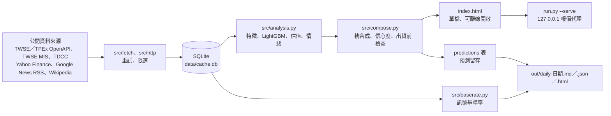

# stock-forecast-dashboard

每天抓取台股與美股的公開資料，用統計模型算出未來 20 個交易日的目標價區間、技術訊號的歷史基準率與每日日報，輸出成可離線開啟的 HTML。

> **非投資建議**：本專案所有輸出都是程式依公開資料計算的統計結果，不是投資建議，也不構成任何買賣要約。製作者不是持牌投資顧問，投資決策與風險請自行判斷與承擔。產出的頁面也會顯示同樣的聲明（`src/render.py` 的 `DISCLAIMER`）。

## 功能

- **資料抓取**：台股取上市＋上櫃普通股依成交值排序前 300 檔，美股取 Wikipedia S&P 500 成分股表的前 200 列（檔數可用 `--tw`、`--us` 調整），日線抓 3 年，另抓基本面、三大法人、融資融券、股利、集保大戶持股、美股分析師目標價與新聞。單一來源失敗只記錄為「降級」，不中斷整份報表（`src/pipeline.py`）。
- **技術面模型**（`src/models/technical.py`）：LightGBM 分位數回歸，同時預測 q10／q50／q90，標籤是 20 日**超額報酬**（個股報酬減同市場基準 0050.TW／SPY）。依日期做 70%／15%／15% 時序切分，並在訓練集尾端 purge 掉 20 個交易日，避免標籤窗口洩漏到驗證期。
- **與動能基準比較**（`src/analysis.py`）：在測試集上計算 IC（Spearman 秩相關）與五分位報酬，並和「純 20 日動能」的 IC 對照，執行時會印出模型是否勝過基準。
- **基本面估值**（`src/models/valuation.py`）：規則式同業相對估值，拿 PE／PB／殖利率和同業分布的 20／50／80 百分位比較。同業優先取同市場同產業，不足 5 檔時退回同市場全體，不跨市場比較。
- **三軌合成**（`src/compose.py`）：技術面、估值、分析師目標價三軌加權合成目標價區間，權重依資料品質調整。信心度 0–100 由三軌一致性、資料完整度、模型測試集 IC、預測區間寬度四個因子組成，頁面會攤開顯示。日線不足 120 根、三軌方向分歧、中位預測超出該檔自身波動區間，或信心度低於 40 時，判為「不可預測」，只呈現資料、不給預測值。
- **新聞情緒**（`src/models/sentiment.py`）：**詞典法**，不呼叫外部 AI。自訂中文財經詞典加 Loughran-McDonald 英文詞典精簡子集，情緒詞前面出現否定詞時翻轉極性，以 `tanh` 壓到 [-1, 1]，再依新聞時間做半衰期 3.5 天的加權（只看 7 天內）。新聞來源是 Google News RSS。情緒只對合成目標價做 ±5% 以內的微調，不單獨產生目標價。
- **訊號基準率**（`src/baserate.py`、`src/signals/`）：10 個技術面訊號 × 2 個市場 × 5／10／20 日三個期間，按日期區塊做 block bootstrap（預設 2,000 次）估計觸發組與未觸發組的超額報酬差，全部檢定一起做 Benjamini-Hochberg 校正。判定分為「有統計優勢／無統計優勢／跨期不穩定／樣本不足」，只有判為有統計優勢的訊號會進看多榜。
- **預測留存與事後驗證**（`src/accuracy.py`）：每次執行把可預測個股的預測寫進 SQLite `predictions` 表，之後用 `--accuracy` 比對實際超額報酬，輸出方向命中率（附二項檢定 p 值）、IC、多空價差。
- **每日日報**（`src/digest.py`）：同一份資料輸出 Markdown、JSON、HTML 三種格式到 `out/`，準度摘要放最上面；沒有任何訊號有統計優勢時會明寫，不留白。
- **資金規則試算**（`src/allocate.py`，選用）：讀 `portfolio.toml` 裡你自己設定的本金、單檔上限、分批比例與標的，換算成股數、成本、手續費與歷史回撤，只算規則的後果，不挑股票、不建議比例。
- **本機報價代理**（`src/serve.py`）：`--serve` 只允許綁定本機位址（預設 `127.0.0.1:8848`），提供 `index.html` 與 `/api/live?symbols=...` 端點，由 Python 代為向 TWSE MIS 取台股即時報價（交易所端點不回傳 CORS 標頭，靜態頁面無法直接取得）。每次最多 60 檔，上游結果快取 5 秒，上游失敗時回最後一次成功的快照並標示過期。
- **頁面用字檢查**：`src/render.py` 定義一份禁止出現的指示性字眼（例如「建議買進」），測試會掃描產出的 HTML。

## 架構



| 路徑 | 用途 |
| --- | --- |
| `run.py` | 進入點（argparse） |
| `config.py` | 所有可調參數：檔數、預測期間、基準、限速、`--serve` 埠號等 |
| `src/fetch/` | 各資料來源的抓取與解析 |
| `src/http.py` | 共用 HTTP 層：最小間隔限速、urllib3 重試加應用層重試、Yahoo cookie＋crumb 握手 |
| `src/store.py` | SQLite schema 與 upsert |
| `src/models/` | 技術面、估值、情緒三個模型 |
| `src/signals/` | 技術面訊號 registry |
| `src/templates/` | 頁面與日報的 Jinja2 模板、CSS、JS |
| `scripts/*.cmd` | Windows 工作排程器用的每日與每週批次檔 |
| `docs/superpowers/` | 設計規格與實作計畫 |

## 技術

- Python（已在 3.13 執行測試；程式用到 `tomllib` 與 `datetime.UTC`，至少需要 3.11，3.11／3.12 未實測）
- pandas、numpy、scipy、LightGBM
- requests、urllib3、certifi、lxml
- Jinja2（頁面模板）
- SQLite（標準函式庫 `sqlite3`）
- pytest

## 如何執行

`pyproject.toml` 沒有列出相依套件，以下是從程式的 import 整理出來的必要套件（未鎖定版本）：

```bash
pip install pandas numpy scipy lightgbm requests certifi lxml jinja2 pytest
```

常用指令（都在專案根目錄執行）：

```bash
# 抓資料 → 訓練模型 → 產生 index.html → 留存預測
python run.py

# 只抓資料／只重算模型與頁面（不重抓）
python run.py --fetch-only
python run.py --no-fetch

# 調整選股池大小（預設台股 300、美股 200）
python run.py --tw 50 --us 30

# 重算全部訊號的歷史基準率（走全歷史，較慢；--boot 調整 bootstrap 次數，預設 2000）
python run.py --baserates

# 產出每日日報到 out/（需要先跑過 python run.py 與 --baserates）
python run.py --digest

# 比對已留存的預測與實際走勢
python run.py --accuracy

# 本機即時模式（需要先有 index.html），預設 http://127.0.0.1:8848
python run.py --serve
```

產出檔案都已列在 `.gitignore`：`data/cache.db`、根目錄的 `index.html`、`out/`、`logs/`。

### Windows 排程

- `scripts/daily.cmd`：依序執行 `python run.py` 與 `python run.py --digest`，紀錄附加到 `logs/daily.log`。
- `scripts/baserates.cmd`：執行 `python run.py --baserates`，紀錄附加到 `logs/baserates.log`，設計為每週一次。
- 兩支腳本把 Python 路徑寫死在 `PY` 變數，換機器要先改；工作排程器的任務需要自行建立，repo 內沒有註冊腳本。

## 設定

- 沒有使用環境變數，也不需要任何 API key。
- 可調參數集中在 `config.py`。
- 資金規則試算為選用功能：複製 `portfolio.toml.example` 為 `portfolio.toml` 再修改。`portfolio.toml` 含本金金額，已列入 `.gitignore`，不要提交。

## 測試

```bash
python -m pytest
```

2026-10-30 在本機（Python 3.13.9）執行結果：548 passed。資料來源的解析測試使用 `tests/fixtures/` 的樣本回應。

## 限制與已知問題

- `run.py` 定義了 `--full`、`--only`、`--backtest` 三個參數，但 `main()` 沒有處理，目前指定了也沒有作用。
- 新聞情緒是關鍵詞比對，情緒詞典尚未有標註資料評估，無法說明它的準確度。
- 資料來源包含 Yahoo Finance 的非官方 API（需要 cookie＋crumb 握手）與 Google News RSS，兩者都不是正式提供給程式使用的介面，隨時可能變更或封鎖；使用前請自行確認各來源的服務條款與使用限制。美股選股池則是解析 Wikipedia 頁面而來。
- 美股選股池取 Wikipedia 成分股表的前 200 列（依表格原本的順序），不是依市值挑選；設計規格寫的是市值排序，實作與規格不一致。
- 分析師目標價只有美股；台股沒有免費的分析師前瞻 EPS，估值軌道的權重會打折。
- 基本面每次只存當下快照，沒有歷史 PE，所以估值採同業相對估值，同業樣本少或商業模式差異大時可能失真（合理價高於現價 2 倍或低於現價一半的估值會被排除，不納入合成）。
- `--serve` 目前只有台股報價：`src/fetch/live.py` 只實作 TWSE MIS，啟動訊息與頁面註腳提到的美股 Yahoo 報價尚未實作；頁面的 `app.js` 也還沒有呼叫 `/api/live`，所以開啟頁面不會自動更新報價。
- 技術面目標價換算時假設大盤同期報酬為 0。
- 基準率只涵蓋技術面訊號；籌碼、基本面、事件類訊號因資料只有單日快照，沒有放進 registry。
- 預測準度要靠留存資料累積，repo 內沒有附上統計結果；請在本機用 `python run.py --accuracy` 查看。
- 排程腳本只適用 Windows。
